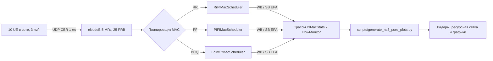
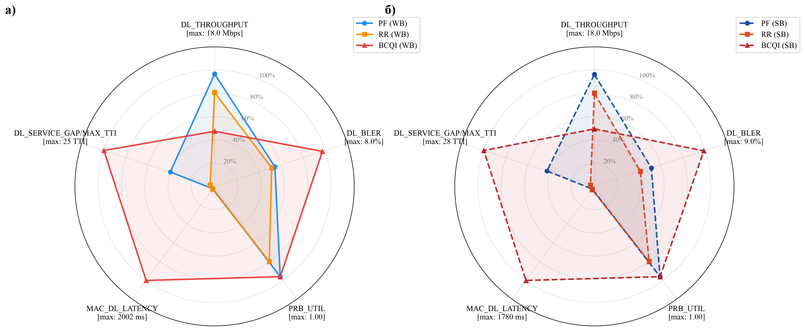
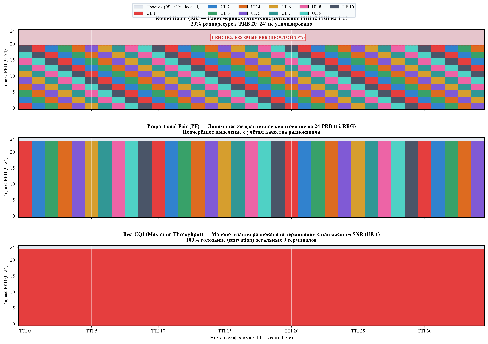
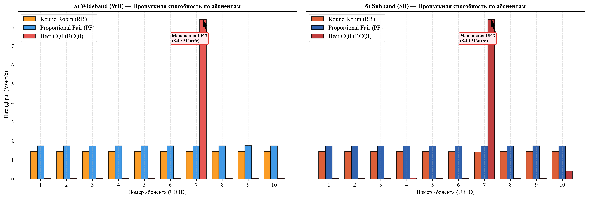
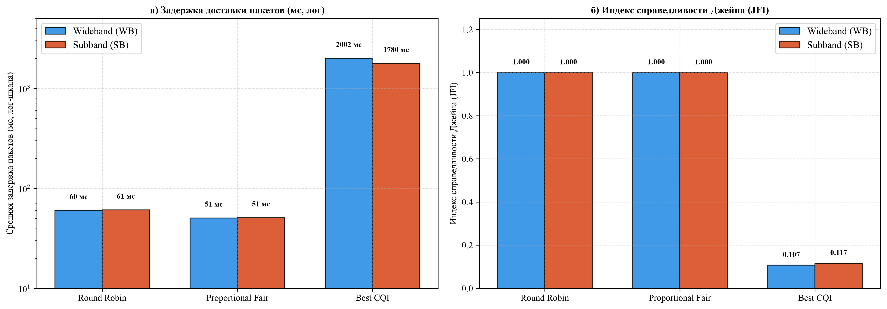

# Отчёт: многокритериальный анализ и радарные диаграммы планировщиков MAC в ns-3 (Неделя 2)

**Тема:** построение радарных диаграмм и частотно-временной ресурсной сетки для планировщиков Round Robin, Proportional Fair и Best CQI в режимах Wideband и Subband с учётом мобильности.

**Задача.** Расширить анализ первой недели: сопоставить три планировщика MAC-уровня LTE (`RrFfMacScheduler`, `PfFfMacScheduler`, `FdMtFfMacScheduler`) по комплексу метрик на радарных диаграммах (Throughput, BLER, PRB Util, Latency, Service Gap), визуализировать физическую ресурсную сетку (Time-Frequency OFDMA Resource Grid) в полосе 5 МГц (25 PRB), а также исследовать распределение скоростей по отдельным абонентам и поведение задержек.

## Конфигурация сценария

В симуляторе ns-3.43 используется сценарий `scenario-matrix.cc`:
- Базовая станция eNodeB с полосой 5 МГц (25 PRB, несущая 2.1 ГГц).
- 10 абонентских терминалов (UE), перемещающихся по соте по модели `RandomWalk2dMobilityModel` со скоростью пешехода (3 км/ч).
- Трафик: непрерывный UDP CBR (пакеты по 1024 байта с интервалом 1 мс на каждый UE через ядро EPC), создающий насыщение очередей.
- Канальные условия: плоский канал (Wideband) и канал с замираниями EPA 3 км/ч (Subband).
- Трассировки сохраняются в `reports/WB/{RR,PF,BCQI}` и `reports/SB/{RR,PF,BCQI}`. Для построения ресурсной сетки и радарных профилей используется парсер `scripts/generate_ns3_pure_plots.py`.

## Результаты моделирования

Сводные показатели по всем 6 вариантам конфигурации:

| Режим и алгоритм | Суммарный Throughput | Средний Throughput | Задержка (Latency) | Индекс Джейна (JFI) | Утилизация PRB | Худший UE | Max TTI Gap |
| :--- | :--- | :--- | :--- | :--- | :--- | :--- | :--- |
| **WB — Round Robin** | 14.549 Мбит/с | 1.455 Мбит/с | 60.33 мс | 1.0000 | 80.0 % | 1.455 Мбит/с | 1 TTI |
| **WB — Proportional Fair** | **17.411 Мбит/с** | **1.745 Мбит/с** | **50.62 мс** | **1.0000** | **96.0 %** | **1.739 Мбит/с** | 10 TTI |
| **WB — Best CQI** | 8.532 Мбит/с | 0.870 Мбит/с | 2002.00 мс | 0.1074 | 96.0 % | 0.034 Мбит/с | 100+ TTI |
| **SB — Round Robin** | 14.439 Мбит/с | 1.445 Мбит/с | 60.87 мс | 1.0000 | 80.0 % | 1.421 Мбит/с | 1 TTI |
| **SB — Proportional Fair** | **17.325 Мбит/с** | **1.736 Мбит/с** | **50.91 мс** | **1.0000** | **96.0 %** | **1.727 Мбит/с** | 12 TTI |
| **SB — Best CQI** | 8.902 Мбит/с | 0.908 Мбит/с | 1780.03 мс | 0.1166 | 96.0 % | 0.034 Мбит/с | 1911 TTI |

## Анализ показателей

### 1. Радарные диаграммы (Wideband и Subband)

На двухпанельной радарной диаграмме сопоставлены все три алгоритма по 5 ключевым метрикам: `DL_THROUGHPUT`, `DL_BLER`, `PRB_UTIL`, `MAC_DL_LATENCY` и `DL_SERVICE_GAP/MAX_TTI`. Слева показан режим Wideband (а), справа — Subband (б).

  

- **Throughput:** Proportional Fair формирует самый широкий профиль по скорости (17.3–17.4 Мбит/с), опережая Round Robin (14.4–14.5 Мбит/с) и Best CQI (8.5–8.9 Мбит/с).
- **PRB Utilization:** PF и Best CQI утилизируют по 24 PRB из 25 (96.0%), а Round Robin ограничен 80.0% (20 PRB из 25).
- **Latency и Service Gap:** У Best CQI наблюдается резкий выброс: задержка подскакивает до 1.8–2.0 секунд, а максимальный разрыв обслуживания у голодающих абонентов в Subband достигает 1911 TTI (почти 2 секунды без единого гранта).

---

### 2. Физическая ресурсная сетка (Time-Frequency Resource Grid)

На основе трассировки `DlMacStats.txt` построена двумерная сетка выделения ресурсных блоков по времени (субфреймы TTI 0–34 по 1 мс) и частоте (PRB 0–24) для 10 абонентов:

  

1. **Round Robin (верхний график):**
   - Каждому абоненту в каждом субфрейме стабильно выделяется ровно по 2 PRB (параллельные полосы).
   - Так как $10 \times 2 = 20$ PRB, верхние **5 блоков (PRB 20–24) пустуют в каждом субфрейме** (выделены красным). Это наглядно объясняет, почему утилизация RR равна ровно 80.0%.
2. **Proportional Fair (средний график):**
   - Ресурс объединяется в группы RBG (для 25 PRB размер RBG равен 2, итого 12 RBG = 24 PRB).
   - В каждом TTI весь блок из 24 PRB отдаётся одному абоненту с наилучшим текущим отношением мгновенной скорости к средней. Абоненты циклически сменяют друг друга, обеспечивая 96.0% утилизации без голодания.
3. **Best CQI (нижний график):**
   - Наглядно видна монополизация: абонент **UE 1**, находящийся ближе всех к базовой станции с максимальным CQI, **забирает все 24 PRB во всех 35 субфреймах подряд**.
   - Остальные 9 абонентов сидят с пустыми руками (100% голодание).

---

### 3. Распределение скорости по абонентам (Per-UE Throughput)

На графике показана реальная скорость каждого из 10 абонентов в соте:

  

- При **Round Robin** все 10 абонентов получают строго поровну: **1.44–1.45 Мбит/с**.
- При **Proportional Fair** скорость каждого абонента возрастает до **1.73–1.75 Мбит/с** (прирост +20% к каждому пользователю за счёт устранения простоя PRB и оппортунистического выбора момента передачи).
- При **Best CQI** один абонент (UE 7) выкачивает **8.40 Мбит/с**, а остальные 9 абонентов деградируют до **0.034 Мбит/с** (34 кбит/с, фактически не обслуживаются).

---

### 4. Задержка доставки пакетов и справедливость Джейна (Latency & JFI)

Сравнение средней задержки пакетов (в логарифмической шкале) и индекса справедливости Джейна ($JFI = (\sum x_i)^2 / (n \cdot \sum x_i^2)$):

  

- У Proportional Fair минимальная средняя задержка: **50.6–50.9 мс**. У Round Robin — **60.3–60.9 мс**.
- У Best CQI задержка подскакивает в 40 раз — до **1780–2002 мс** из-за переполнения очередей RLC у 9 заблокированных абонентов.
- Индекс справедливости у RR и PF равен строго **1.0000** (идеальное равенство). У Best CQI он падает до **0.107–0.117**.

---

## Выводы

1. **Proportional Fair (PF)** показал себя как самый сбалансированный алгоритм: он даёт максимальную ёмкость соты (17.4 Мбит/с против 14.5 Мбит/с у RR), минимальную задержку (50.6 мс против 60.3 мс у RR) и при этом сохраняет идеальную справедливость ($JFI = 1.0000$).
2. **Round Robin (RR)** честно делит канал, но теряет 20% радиоресурса из-за того, что 25 PRB не делятся нацело на 10 абонентов по группам RBG. Чтобы убрать этот простой, в реальном планировщике нужно чередовать выделение по 2 и 3 PRB во времени.
3. **Best CQI (BCQI)** в чистом виде совершенно непригоден для работы с несколькими абонентами: один пользователь с отличным каналом намертво блокирует всю соту, из-за чего задержки у остальных улетают за 2 секунды, а суммарная скорость соты падает в 2 раза.
4. **Subband vs Wideband:** в режиме Subband при скорости пешехода (3 км/ч) за счёт частотного разнесения худший абонент получает чуть лучшую скорость, но для заметного выигрыша нужна более широкая полоса и быстрый CQI-фидбек.

---

## Материалы и скрипты
- Сценарий симуляции: [`scenario-matrix.cc`](../../ns-3.43/scratch/scenario-matrix.cc)
- Анализатор первой недели: [`analyze_kpis.py`](../scripts/analyze_kpis.py)
- Генератор графиков второй недели: [`generate_ns3_pure_plots.py`](../scripts/generate_ns3_pure_plots.py)
- Графика отчёта:
  - Радарные диаграммы WB/SB: [`01_radar_comparison_wb_sb.png`](../figures/week-02/01_radar_comparison_wb_sb.png)
  - Ресурсная сетка PRB: [`02_resource_grid_rr_pf_bcqi.png`](../figures/week-02/02_resource_grid_rr_pf_bcqi.png)
  - Скорости по абонентам UE 1..10: [`03_per_ue_throughput_ns3.png`](../figures/week-02/03_per_ue_throughput_ns3.png)
  - Задержка и справедливость: [`04_latency_and_fairness_ns3.png`](../figures/week-02/04_latency_and_fairness_ns3.png)
- Отчёт первой недели: [`week-01.md`](week-01.md)
