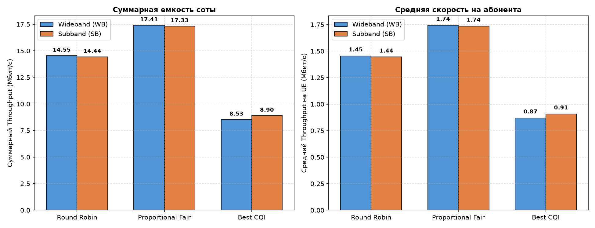
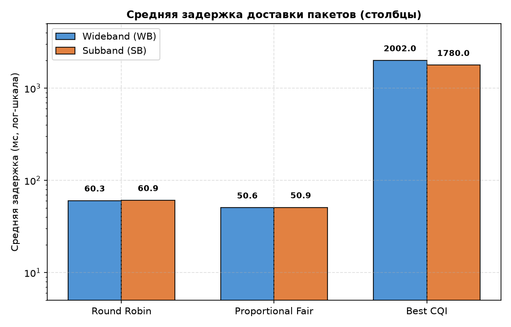
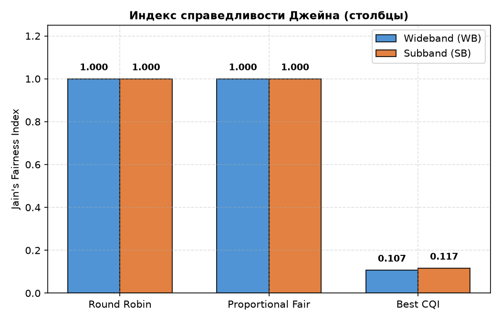
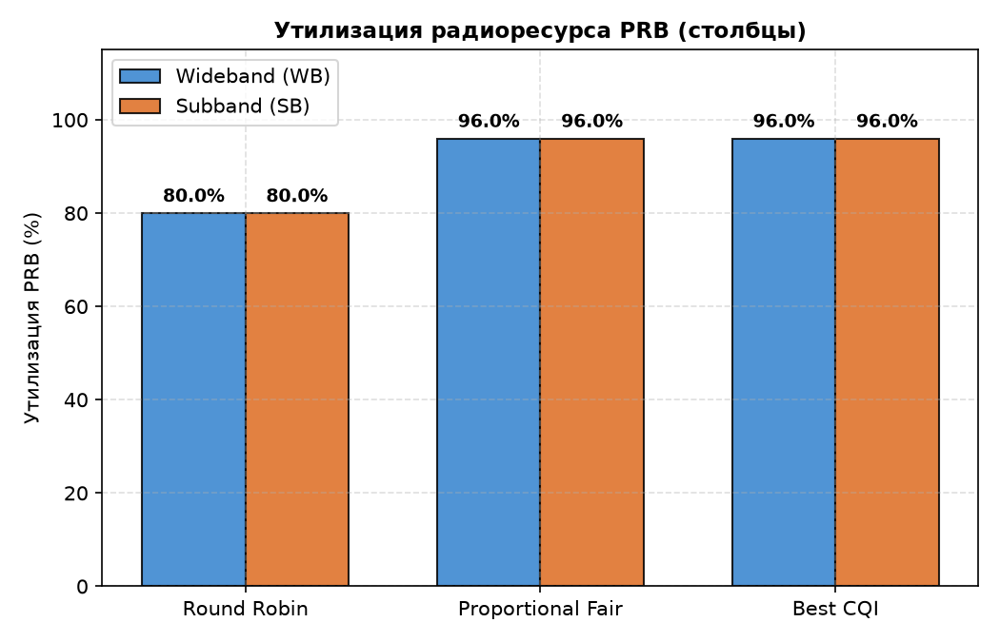
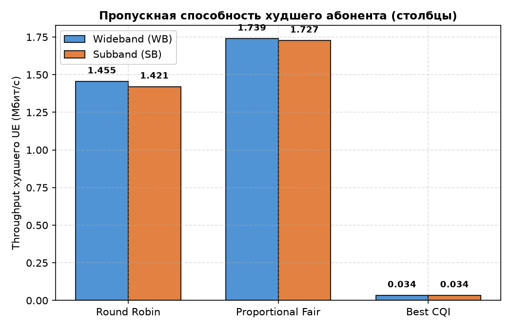
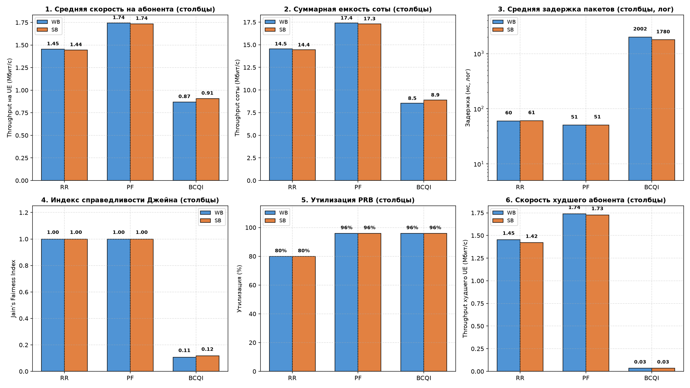

# Отчёт: сравнение планировщиков MAC в ns-3

**Тема:** сравнение алгоритмов планирования Round Robin, Proportional Fair и Best CQI в режимах Wideband и Subband с учётом мобильности абонентов.

**Задача.** Исследовать поведение трёх алгоритмов планирования MAC-уровня LTE — Round Robin (RR), Proportional Fair (PF) и Best CQI (Maximum Throughput) — в условиях плоского канала (Wideband) и частотно-селективного канала с замираниями (Subband). Сравнить ключевые характеристики: суммарную и пользовательскую пропускную способность, задержку доставки пакетов, индекс справедливости Джейна (JFI), утилизацию ресурсных блоков (PRB) и скорость худшего абонента.

```mermaid
flowchart LR
    A[Remote Host] -->|UDP CBR| B[eNodeB 5 МГц, 25 PRB]
    B -->|Случайное блуждание 3 км/ч| C[10 UE в соте]
    C -->|WB: плоский / SB: замирания| D[Трассы в reports/{WB,SB}]
    D --> E[tools/analyze_kpis.py]
    E --> F[Метрики и столбчатые диаграммы]
```

## Конфигурация сценария

В симуляторе ns-3.43 развёрнута сота с одной базовой станцией (полоса 5 МГц, 25 PRB) и 10 абонентскими терминалами. Абоненты перемещаются в пределах соты по модели `RandomWalk2dMobilityModel` со скоростью пешехода (3 км/ч). Моделирование проведено для двух канальных условий: плоский канал (Wideband) и многолучевой канал с замираниями (Subband).

Трафик генерируется удалённым хостом через ядро EPC в виде непрерывных UDP-потоков (CBR, пакеты по 1024 байта с интервалом 1 мс на каждый терминал), создавая полное насыщение канала.

Трассировки сохраняются раздельно в каталогах `reports/WB/{RR,PF,BCQI}` и `reports/SB/{RR,PF,BCQI}`. Расчёт занятости PRB выполняется парсером `tools/analyze_kpis.py` по таблице транспортных блоков 3GPP TS 36.213 (`TransportBlockSizeTable[110][27]`), восстанавливая точное число выделенных PRB для каждой пары MCS и TBS в субфрейме.

## Результаты моделирования

Сводные показатели по всем 6 вариантам конфигурации:

| Режим и алгоритм | Суммарный Throughput | Средний Throughput | Задержка (Latency) | Индекс Джейна (JFI) | Утилизация PRB | Худший UE |
| :--- | :--- | :--- | :--- | :--- | :--- | :--- |
| **WB — Round Robin** | 14.549 Мбит/с | 1.455 Мбит/с | 60.33 мс | 1.0000 | 80.0 % | 1.455 Мбит/с |
| **WB — Proportional Fair** | 17.411 Мбит/с | 1.745 Мбит/с | 50.62 мс | 1.0000 | 96.0 % | 1.739 Мбит/с |
| **WB — Best CQI** | 8.532 Мбит/с | 0.870 Мбит/с | 2002.00 мс | 0.1074 | 96.0 % | 0.034 Мбит/с |
| **SB — Round Robin** | 14.439 Мбит/с | 1.445 Мбит/с | 60.87 мс | 1.0000 | 80.0 % | 1.421 Мбит/с |
| **SB — Proportional Fair** | 17.325 Мбит/с | 1.736 Мбит/с | 50.91 мс | 1.0000 | 96.0 % | 1.727 Мбит/с |
| **SB — Best CQI** | 8.902 Мбит/с | 0.908 Мбит/с | 1780.03 мс | 0.1166 | 96.0 % | 0.034 Мбит/с |

## Анализ показателей

### 1. Пропускная способность (Throughput)
На левом графике показана суммарная ёмкость соты, на правом — средняя пользовательская скорость на абонента.

Proportional Fair обеспечивает наибольшую суммарную ёмкость соты — 17.3–17.4 Мбит/с и среднюю пользовательскую скорость 1.74 Мбит/с. Round Robin обеспечивает 14.4–14.5 Мбит/с суммарной скорости и 1.45 Мбит/с на абонента.

У Best CQI суммарный Throughput проседает до 8.5–8.9 Мбит/с, а средняя скорость на абонента падает до 0.87–0.91 Мбит/с. При этом реальный объём данных прокачивается почти исключительно через одного абонента с наивысшим качеством радиоканала.

<p align="center">
  
</p>

### 2. Задержка доставки пакетов (Latency)
Средняя задержка пакетов представлена на столбчатой диаграмме в логарифмической шкале.

Для Proportional Fair задержка составляет 50.6–50.9 мс, у Round Robin — 60.3–60.9 мс. 

В случае Best CQI средняя задержка подскакивает до 1.8–2.0 секунд (1780–2002 мс). Так как девять терминалов почти не получают грантов на передачу, пакеты в буферах RLC накапливаются в очередях.

<p align="center">
  
</p>

### 3. Индекс справедливости Джейна (JFI)
Индекс справедливости $JFI = (\sum x_i)^2 / (n \cdot \sum x_i^2)$ у Round Robin и Proportional Fair равен строго 1.0000 как в Wideband, так и в Subband. Это указывает на равномерное разделение полосы без дискриминации терминалов.

При использовании Best CQI индекс падает до 0.107–0.117 из-за монополизации радиоресурса абонентом с максимальным CQI.

<p align="center">
  
</p>

### 4. Утилизация радиоресурса (PRB Utilization)
В полосе 5 МГц на субфрейм доступно 25 PRB. Round Robin делит ресурс поровну между 10 терминалами по 2 PRB на пользователя, расходуя 20 блоков из 25. Оставшиеся 5 PRB остаются нераспределёнными, что даёт фиксированную загрузку ровно 80.0%.

Proportional Fair и Best CQI группируют ресурсные блоки в группы RBG (для 25 PRB размер RBG равен 2) и утилизируют 24 PRB из 25, обеспечивая 96.0% загрузки радиоканала.

<p align="center">
  
</p>

### 5. Скорость худшего абонента (Worst UE Throughput)
Худший абонент при алгоритме Proportional Fair получает стабильные 1.727–1.739 Мбит/с, а при Round Robin — 1.421–1.455 Мбит/с. 

При алгоритме Best CQI пропускная способность худшего абонента деградирует до 0.034 Мбит/с (34 кбит/с), что свидетельствует о практически полном отсутствии обслуживания на краю соты.

<p align="center">
  
</p>

### Сводный дашборд
Сравнение всех пяти ключевых метрик по матрице сценариев:

<p align="center">
  
</p>

## Материалы и скрипты
- Сценарий симуляции: [`scenario-matrix.cc`](../../ns-3.43/scratch/scenario-matrix.cc)
- Анализатор и генератор графиков: [`analyze_kpis.py`](../scripts/analyze_kpis.py)
- Каталоги трассировок: `reports/WB/` и `reports/SB/`
- Графика отчёта: [`01_throughput_matrix.png`](figures/01_throughput_matrix.png), [`02_latency_matrix.png`](figures/02_latency_matrix.png), [`03_fairness_jfi_matrix.png`](figures/03_fairness_jfi_matrix.png), [`04_prb_utilization_matrix.png`](figures/04_prb_utilization_matrix.png), [`05_worst_ue_matrix.png`](figures/05_worst_ue_matrix.png), [`kpi_matrix_dashboard.png`](figures/kpi_matrix_dashboard.png)
