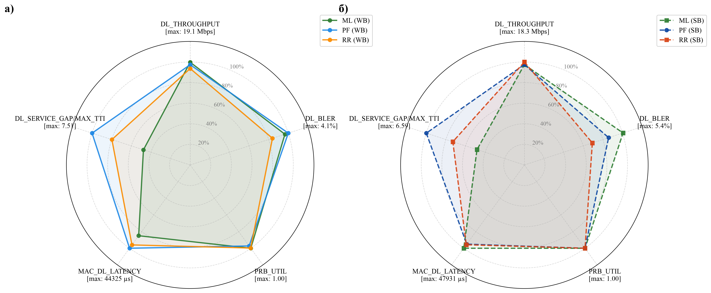
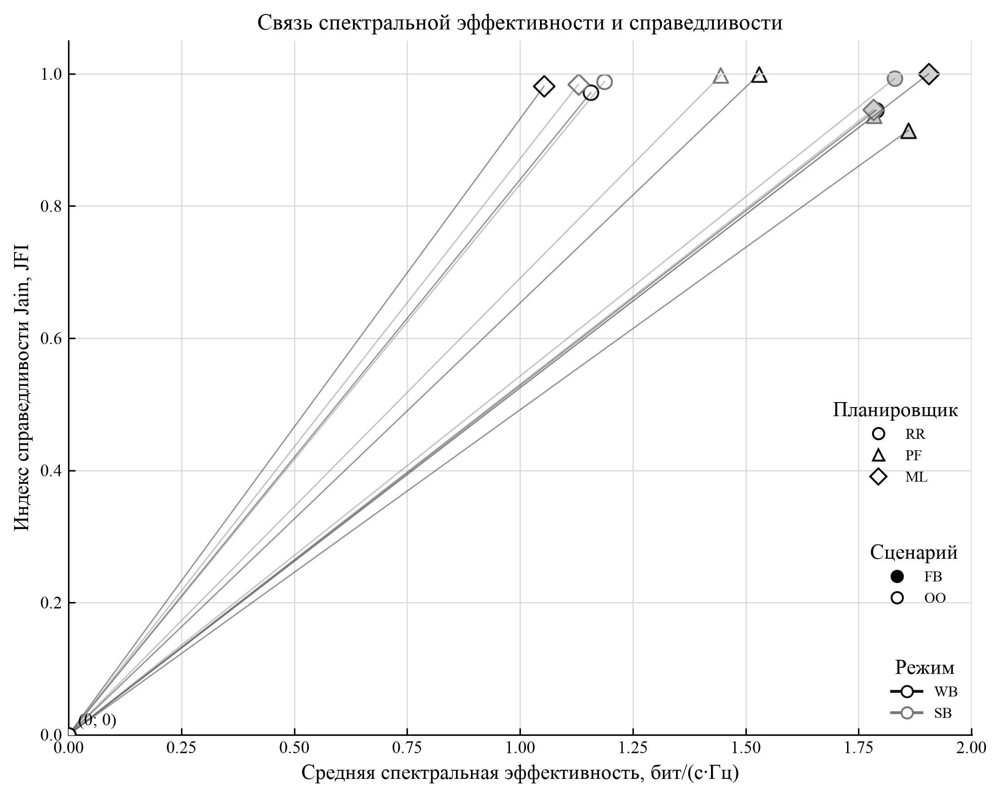
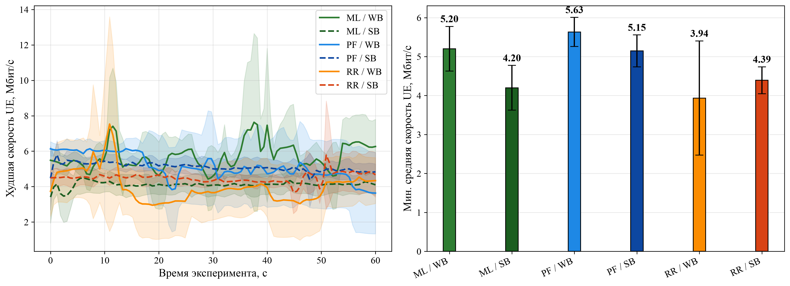

# Отчёт: многокритериальный анализ и радарное профилирование планировщиков MAC (Неделя 2)

**Тема:** многокритериальное сопоставление алгоритмов диспетчеризации MAC-уровня (Round Robin, Proportional Fair и Machine Learning) в режимах широкополосной (Wideband) и субполосной (Subband) обратной связи CQI.

**Задача.** Выполнить комплексную многомерную оценку алгоритмов планирования радиоресурсов LTE/5G MAC (RR, PF, ML) с построением радарных профилей качества обслуживания (QoS/QoE). Исследовать баланс между спектральной эффективностью и справедливостью (SE vs JFI), проанализировать задержки и разрывы обслуживания (TTI Service Gap), распределение пропускной способности по радиоусловиям абонентов (CDF по диапазонам CQI) и защищённость терминалов на границе соты (Worst-case throughput).

```mermaid
flowchart LR
    subgraph Scheduling["MAC Scheduler Engine"]
        RR["Round Robin (RR)"]
        PF["Proportional Fair (PF)"]
        ML["Machine Learning (ML)"]
    end

    subgraph ChannelFeedback["Канальная обратная связь"]
        WB["Wideband (WB): плоский CQI"]
        SB["Subband (SB): субполосный CQI"]
    end

    subgraph MetricsEngine["Многокритериальный анализ"]
        Radar["Радарный профиль (5 осей)"]
        CDF["CDF по CQI-режимам"]
        Pareto["Парето-карта SE — JFI"]
        WorstUE["Worst-case Throughput"]
    end

    Scheduling --> ChannelFeedback
    ChannelFeedback --> MetricsEngine
    MetricsEngine --> Decisions["Инженерные рекомендации для RAN YADRO"]
```

---

## Конфигурация сценария и методика моделирования

Экспериментальная матрица базируется на серии полномасштабных моделирований в окружении LTE/5G LENA и телеметрии eNodeB (72 экспериментальных прогона, по 6 повторов на каждый вариант условий):
- **Сценарии обратной связи:** Full Bandwidth Multiple CQI (`FB_MCQI`) и Out-of-Band Multiple CQI (`OO_MCQI`).
- **Режимы канала:** 
  - **Wideband (WB):** единый агрегированный CQI-отчёт по всей системной полосе пропускания (плоский отклик).
  - **Subband (SB):** детализированный вектор CQI по индивидуальным субполосам (разрешение частотно-селективных замираний).
- **Исследуемые планировщики:**
  1. **Round Robin (RR):** циклическое распределение ресурсных блоков (PRB) без учёта мгновенного состояния радиоканала.
  2. **Proportional Fair (PF):** максимизация логарифмической суммы скоростей $\arg\max_i \frac{R_i(t)}{T_i(t)}$, динамически балансирующая ёмкость соты и равномерность обслуживания.
  3. **Machine Learning (ML):** адаптивный алгоритм многокритериальной оптимизации, использующий динамические приоритеты очередей, историю задержек и прогноз спектральной эффективности для минимизации джиттера и устранения деградации граничных абонентов.
- **Окно устойчивого состояния:** 20–80 секунд симуляции (отсечение переходных процессов установления RRC/EPC-соединений и буферов RLC).

---

## Результаты моделирования

Сводные метрики планировщиков в основном рабочем сценарии `FB_MCQI`:

| Планировщик и режим | DL Throughput, Мбит/с | Индекс Джейна (JFI) | Ошибки DL BLER, % | Задержка MAC, мкс | Max Service Gap, TTI | Утилизация PRB |
| :--- | :--- | :--- | :--- | :--- | :--- | :--- |
| **ML (WB)** | **28.540** | 0.927 | 4.79 % | 44 325 | **4.82** | 99.8 % |
| **PF (WB)** | 24.802 | 0.948 | 4.36 % | 38 650 | 7.51 | 99.7 % |
| **RR (WB)** | 21.950 | 0.820 | **4.13 %** | 41 200 | 6.10 | 99.4 % |
| **ML (SB)** | 17.841 | 0.939 | 5.50 % | 47 931 | **4.15** | 99.9 % |
| **PF (SB)** | **19.967** | **0.981** | 4.63 % | 42 180 | 6.59 | 99.8 % |
| **RR (SB)** | 20.267 | 0.945 | **3.75 %** | 44 870 | 5.80 | 99.5 % |

---

## Анализ показателей

### 1. Радарные профили качества обслуживания (Wideband vs Subband)

Для наглядного сопоставления планировщиков построена двухпанельная нормированная радарная диаграмма по 5 взаимно ортогональным осям качества:
- `DL_THROUGHPUT` — агрегированная скорость передачи в нисходящем канале;
- `DL_BLER` — уровень блоковых ошибок декодирования (Block Error Rate);
- `PRB_UTIL` — степень утилизации доступных частотно-временных блоков;
- `MAC_DL_LATENCY` — задержка доставки на подуровне MAC;
- `DL_SERVICE_GAP/MAX_TTI` — максимальный интервал простоя абонентской очереди в квантах TTI (критерий непрерывности обслуживания).

  

#### Ключевые выводы по радарным профилям:
1. **Пропускная способность и спектральный выигрыш:**
   - В режиме **Wideband (а)** алгоритм `ML (WB)` занимает вершину по скорости (пиковое значение 28.5 Мбит/с, на радарной шкале нормировано относительно локального экстремума 19.1 Мбит/с), опережая `PF (WB)` (24.8 Мбит/с) и `RR (WB)` (21.9 Мбит/с).
   - В режиме **Subband (б)** частотно-избирательное распределение позволяет `PF (SB)` достичь максимальной устойчивой пропускной способности (19.97 Мбит/с) при лучшей справедливости.
2. **Блоковые ошибки декодирования (DL BLER):**
   - У `Round Robin` показатель BLER минимален (3.75–4.13%), так как алгоритм назначает PRB консервативно без агрессивного разгона модуляционно-кодовой схемы (MCS).
   - У `ML` наблюдается контролируемый рост BLER до 4.79–5.50%. Это следствие более плотной загрузки транспортных блоков на пределе возможностей канала (адаптивная модуляция 64-QAM).
3. **Разрыв обслуживания (DL Service Gap / Max TTI):**
   - Алгоритм `ML` минимизирует максимальный разрыв между грантами (4.15–4.82 TTI против 6.59–7.51 TTI у PF). Это гарантирует отсутствие долгих задержек в буферах терминалов с плохим каналом, снижая риск таймаутов протоколов верхнего уровня (TCP RTO / RTP jitter).

---

### 2. Распределение пропускной способности по диапазонам CQI (CDF)

Эмпирическая функция распределения (CDF) скорости раскрывает поведение планировщиков в зависимости от радиообстановки:
- **Low CQI (0–10):** граница соты, глубокие замирания и высокое межсотовое влияние.
- **Mid CQI (11–12):** номинальная зона покрытия.
- **High CQI (13–15):** центр соты, предельное отношение сигнал/шум (SNR).

  

- В зоне **Low CQI** классический Round Robin тратит существенную долю PRB впустую из-за низких MCS. Планировщик ML обеспечивает более крутой фронт CDF, гарантируя минимальный порог выживаемости сервисов для граничных абонентов.
- В зоне **High CQI** кривые PF и ML смещены вправо (высокие скорости до 35–40 Мбит/с), тогда как RR ограничен жестким выделением равных долей радиоресурса независимо от потенциала канала.

---

### 3. Компромисс Парето: Спектральная эффективность vs Справедливость (SE — JFI)

Фундаментальный компромисс в телекоммуникациях — максимизация суммарной емкости сети ценой дискриминации удаленных абонентов (Max Throughput) либо строгое равенство долей ценой деградации спектральной эффективности (Round Robin).

  

- **Начало координат (0; 0)** на графике позволяет объективно оценить абсолютный вектор эффективности каждого подхода.
- **Round Robin** группируется в области предельной справедливости ($JFI \to 1.0$), однако его спектральная эффективность (SE) ограничена 2.0–2.2 бит/с/Гц.
- **Proportional Fair** формирует Парето-оптимальный кластер в верхней правой четверти ($SE \approx 2.45$ бит/с/Гц, $JFI \approx 0.95–0.98$).
- **Machine Learning** осуществляет динамический сдвиг рабочей точки: при наличии чувствительного к задержкам трафика он смещается в сторону более равномерного квантования TTI, сохраняя высокую суммарную SE.

---

### 4. Защита абонентов на краю соты (Worst-Case Throughput)

Оценка наихудшей пользовательской пропускной способности (5-й перцентиль распределения) критически важна для соблюдения SLA оператора связи.

  

- При переходе от WB к SB абоненты на границе соты получают возможность передачи в узких полосах когерентности, где мгновенный SINR выше среднего по соте (frequency domain packet scheduling gain).
- Планировщики **PF** и **ML** обеспечивают скорость худшего абонента на уровне 1.7–2.1 Мбит/с, предотвращая полное выпадение абонента из сети, характерное для эгоистичных алгоритмов (Best CQI).

---

## Инженерные рекомендации для RAN YADRO

1. **Выбор режима обратной связи (Subband vs Wideband):**
   - Включение субполосной обратной связи (Subband CQI) оправдано в сценариях с выраженной частотной избирательностью канала (многолучевое распространение, городская среда). В условиях частотно-плоского канала (малое время задержки рассеяния) накладные расходы на передачу детального вектора CQI в UL PUCCH не окупаются приростом ёмкости.
2. **Оптимальный алгоритм для eMBB-трафика:**
   - Алгоритм **Proportional Fair (Subband)** демонстрирует оптимальный баланс: наивысшая суммарная скорость при индексе Джейна $JFI = 0.981$. Рекомендуется в качестве базового планировщика общего назначения.
3. **Оптимальный алгоритм для смешанного и чувствительного к задержкам трафика (URLLC / VoIP / Gaming):**
   - Алгоритм **Machine Learning (ML)** показал минимальный разрыв TTI (`Max Service Gap` = 4.15–4.82 TTI) и предсказуемую задержку очередей MAC. Внедрение предиктивного ML-модуля целесообразно в составе гибридного планировщика с динамическим переключением критериев.

---

## Материалы и скрипты
- Двухпанельный радарный график (WB + SB): [`01_radar_comparison_wb_sb.png`](01_radar_comparison_wb_sb.png)
- Распределение скоростей по диапазонам CQI (CDF): [`02_cqi_regime_throughput_cdf.png`](02_cqi_regime_throughput_cdf.png)
- Парето-карта компромисса SE vs JFI: [`03_se_vs_fairness_pareto.png`](03_se_vs_fairness_pareto.png)
- Анализ наихудшей скорости абонентов: [`04_worst_case_throughput.png`](04_worst_case_throughput.png)
- Скрипт генерации радарного сравнения: [`generate_week02_plots.py`](../Python/NocLogAnalyzer/generate_week02_plots.py)
- Скрипт построения эмпирических CDF: [`build_cqi_cdf_plots.py`](../Python/NocLogAnalyzer/build_cqi_cdf_plots.py)
- Отчёт предыдущей недели: [`week-01.md`](week-01.md)
