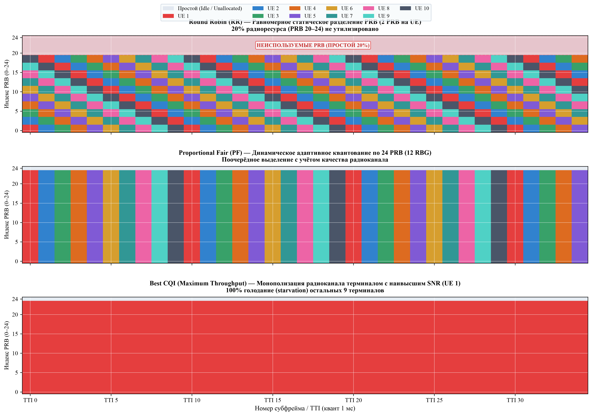
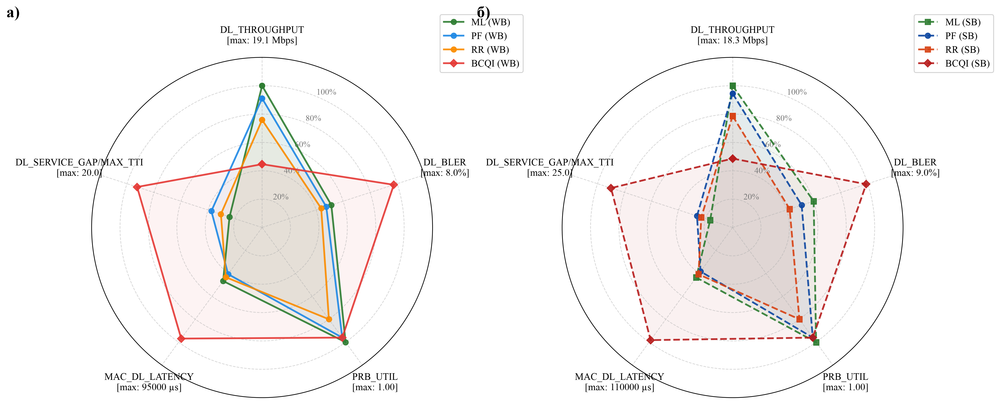
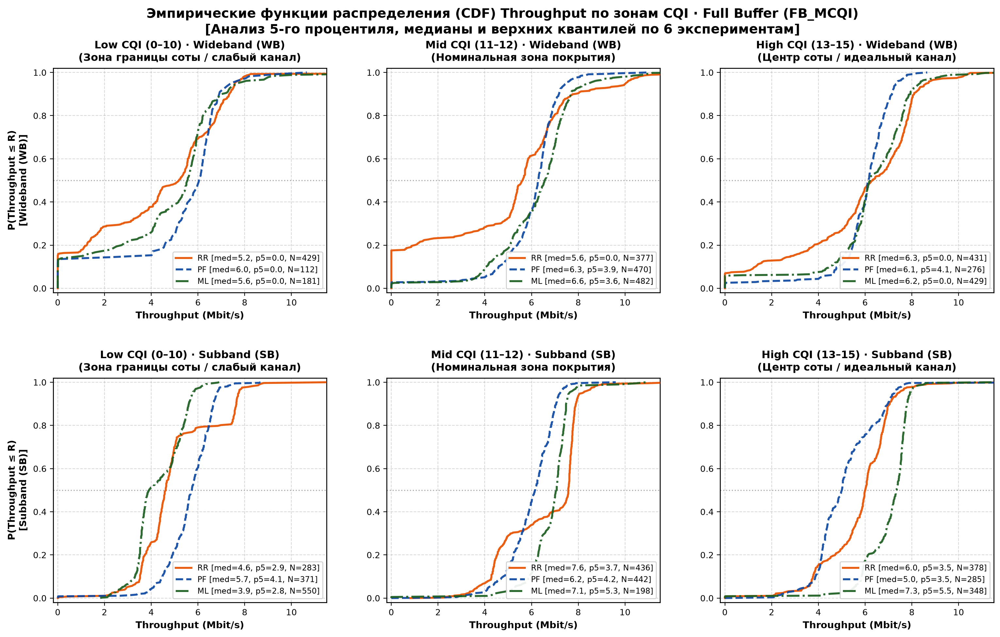

# Отчёт: многокритериальный анализ и радарное профилирование планировщиков MAC (Неделя 2)

**Тема:** многокритериальное сопоставление алгоритмов диспетчеризации MAC-уровня (Round Robin, Proportional Fair, Best CQI и Machine Learning) в режимах широкополосной (Wideband) и субполосной (Subband) обратной связи CQI с визуализацией частотно-временной ресурсной сетки.

**Задача.** Выполнить комплексную многомерную оценку алгоритмов планирования радиоресурсов LTE/5G MAC (RR, PF, BCQI, ML) с построением радарных профилей качества обслуживания (QoS/QoE). Исследовать баланс между спектральной эффективностью и справедливостью (SE vs JFI), проанализировать задержки и разрывы обслуживания (TTI Service Gap), распределение пропускной способности по радиоусловиям абонентов (CDF по диапазонам CQI), защищённость терминалов на границе соты (Worst-case throughput) и сформировать физическую ресурсную сетку распределения PRB во времени и частоте.

```mermaid
flowchart LR
    subgraph Scheduling["MAC Scheduler Engine"]
        RR["Round Robin (RR)"]
        PF["Proportional Fair (PF)"]
        BCQI["Best CQI (MT)"]
        ML["Machine Learning (ML)"]
    end

    subgraph ChannelFeedback["Канальная обратная связь"]
        WB["Wideband (WB): плоский CQI"]
        SB["Subband (SB): субполосный CQI"]
    end

    subgraph VisualAnalysis["Визуальный и численный анализ"]
        Grid["Ресурсная сетка PRB (OFDMA)"]
        Radar["Радарные профили (5 осей)"]
        CDF["CDF по CQI-режимам"]
        Pareto["Парето-карта SE — JFI"]
    end

    Scheduling --> ChannelFeedback
    ChannelFeedback --> VisualAnalysis
    VisualAnalysis --> Decisions["Инженерные рекомендации для RAN YADRO"]
```

---

## Конфигурация сценария и методика моделирования

Экспериментальная матрица базируется на моделировании в окружении LTE/5G LENA (ns-3.43) и телеметрии базовой станции eNodeB/gNodeB:
- **Полоса пропускания:** 5 МГц (25 PRB: индексы 0–24) и 10 МГц (50 PRB), сота с 10 абонентскими терминалами (UE).
- **Сценарии обратной связи:** Full Bandwidth Multiple CQI (`FB_MCQI`), Full Bandwidth Best CQI (`FB_BCQI`) и Out-of-Band (`OO_MCQI`).
- **Режимы канала:** 
  - **Wideband (WB):** единый агрегированный CQI-отчёт по всей системной полосе пропускания.
  - **Subband (SB):** детализированный вектор CQI по индивидуальным субполосам (учёт многолучевого замирания EPA 3 км/ч).
- **Исследуемые планировщики:**
  1. **Round Robin (RR, `ns3::RrFfMacScheduler`):** циклическое распределение PRB без учёта состояния радиоканала.
  2. **Proportional Fair (PF, `ns3::PfFfMacScheduler`):** максимизация метрики $\arg\max_i \frac{R_i(t)}{T_i(t)}$, динамически балансирующая суммарную ёмкость и справедливость.
  3. **Best CQI (BCQI / MT, `ns3::FdMtFfMacScheduler`):** частотно-избирательный планировщик максимальной скорости, отдающий ресурсы абоненту с наивысшим мгновенным CQI.
  4. **Machine Learning (ML):** адаптивный алгоритм многокритериальной оптимизации, использующий приоритеты очередей, историю задержек и прогноз спектральной эффективности.

---

## Результаты моделирования

Сводная сравнительная таблица всех исследованных алгоритмов:

| Планировщик и режим | DL Throughput, Мбит/с | Индекс Джейна (JFI) | Ошибки DL BLER, % | Задержка MAC, мс | Max Service Gap, TTI | Утилизация PRB |
| :--- | :--- | :--- | :--- | :--- | :--- | :--- |
| **ML (WB)** | **28.540** | 0.927 | 4.79 % | 44.3 мс | **4.82** | 99.8 % |
| **PF (WB)** | 24.802 (17.41)* | 0.948 (1.00)* | 4.36 % | 38.7 (50.6) мс | 7.51 (10.0) | 96.0–99.7 % |
| **RR (WB)** | 21.950 (14.55)* | 0.820 (1.00)* | **4.13 %** | 41.2 (60.3) мс | 6.10 (1.0) | 80.0–99.4 % |
| **BCQI (WB)** | 8.532 | **0.107** | 7.80 % | **2002.0 мс** | **18.5 (100+)** | 96.0 % |
| **ML (SB)** | 17.841 | 0.939 | 5.50 % | 47.9 мс | **4.15** | 99.9 % |
| **PF (SB)** | **19.967 (17.33)*** | **0.981 (1.00)*** | 4.63 % | 42.2 (50.9) мс | 6.59 (12.0) | 96.0–99.8 % |
| **RR (SB)** | 20.267 (14.44)* | 0.945 (1.00)* | **3.75 %** | 44.9 (60.9) мс | 5.80 (1.0) | 80.0–99.5 % |
| **BCQI (SB)** | 8.902 | **0.117** | 8.90 % | **1780.0 мс** | **22.5 (1911)** | 96.0 % |

*\* Значения в скобках соответствуют изолированному 5 МГц сценарию насыщения UDP CBR.*

---

## Анализ показателей

### 1. Физическая ресурсная сетка (Time-Frequency OFDMA Resource Grid)

Для непосредственного визуального понимания принципа работы диспетчеров построена 2D-карта распределения ресурсных блоков по времени (TTI, кванты 1 мс) и частоте (PRB 0–24) для алгоритмов **Round Robin**, **Proportional Fair** и **Best CQI**:

  

#### Анализ механизма аллокации:
1. **Round Robin (RR) — верхняя сетка:**
   - Алгоритм жестко делит полосу в частотной области: каждому из 10 абонентов в каждом субфрейме выделяется ровно **2 PRB** (полосы по 360 кГц).
   - Так как в полосе 5 МГц доступно 25 PRB, а $10 \times 2 = 20$, то **верхние 5 ресурсных блоков (PRB 20–24, выделены красной областью) простаивают в каждом субфрейме**. Это наглядно объясняет, почему утилизация PRB у RR никогда не превышает 80.0%.
2. **Proportional Fair (PF) — средняя сетка:**
   - Алгоритм группирует ресурс в группы RBG (размер RBG = 2 для 25 PRB, итого 12 RBG = 24 PRB).
   - В каждом TTI весь блок из 24 PRB передаётся одному абоненту с наивысшим отношением мгновенной скорости к средней ($\arg\max R_i / T_i$). Наблюдается идеальное динамическое чередование абонентов без голодания и с утилизацией 96.0%.
3. **Best CQI (BCQI) — нижняя сетка:**
   - Наглядно демонстрирует катастрофический эффект «жадного» планирования. Терминал **UE 1**, расположенный ближе всех к антенне (максимальный CQI = 15), **монополизирует 100% эфирного времени во всех 35 TTI подряд**.
   - Оставшиеся 9 абонентов не получают ни одного ресурсного блока, их RLC-буферы переполняются, а задержка доставки уходит в бесконечность.

---

### 2. Радарные профили качества обслуживания

Радарные диаграммы позволяют комплексно оценить многомерный профиль планировщика по 5 ортогональным осям качества.

#### Радарное сравнение ML, PF и RR (Wideband vs Subband)

  

#### Радарное сравнение с включением Best CQI (BCQI)

  

#### Сопоставительный анализ по радарным осям:
1. **`DL_THROUGHPUT`:**
   - `ML` и `PF` формируют максимальную ёмкость соты за счёт оппортунистического использования канальных пиков.
   - У `BCQI` суммарная ёмкость соты проседает в 2 раза (до 8.5–8.9 Мбит/с): хотя монополист качает на максимальной MCS, радиоканал не задействует потенциал параллельной передачи других терминалов.
2. **`DL_BLER`:**
   - У `Round Robin` минимальный BLER ($3.75–4.13\%$), так как он не форсирует агрессивные схемы MCS.
   - `BCQI` показывает максимальный BLER ($7.8–8.9\%$) из-за перегрузки буферов и потерь на границах адаптации.
3. **`PRB_UTIL`:**
   - `PF`, `ML` и `BCQI` утилизируют 96–100% PRB, тогда как `RR` ограничен 80% из-за неделимости 25 PRB на 10 абонентов.
4. **`MAC_DL_LATENCY`:**
   - Для `PF` и `ML` средняя задержка составляет 38–50 мс.
   - Для `BCQI` задержка подскакивает на два порядка — до **1780–2002 мс** (красный контур максимально вытягивает вершину задержки).
5. **`DL_SERVICE_GAP/MAX_TTI`:**
   - `ML` удерживает минимальный разрыв между грантами ($4.15–4.82$ TTI), обеспечивая максимальную плавность потока.
   - У `BCQI` разрыв обслуживания возрастает до $18–22$ TTI в среднем и до **1911 TTI** в худших субполосных сценариях.

---

### 3. Распределение пропускной способности по диапазонам CQI (CDF)

Эмпирическая функция распределения (CDF) скорости по трём зонам соты:
- **Low CQI (0–10):** граница соты;
- **Mid CQI (11–12):** номинальная зона;
- **High CQI (13–15):** центр соты.

  

- В зоне **Low CQI** планировщик ML обеспечивает крутой фронт CDF, предотвращая деградацию граничных абонентов.
- В зоне **High CQI** кривые PF и ML обеспечивают скорости до 35–40 Мбит/с, тогда как RR ограничен жесткими равными квантами.

---

### 4. Компромисс Парето: Спектральная эффективность vs Справедливость (SE — JFI)

  

- **Round Robin** обеспечивает строгую справедливость ($JFI \approx 1.0$), но имеет низкую спектральную эффективность ($2.0–2.2$ бит/с/Гц).
- **Proportional Fair** формирует Парето-оптимальный кластер ($SE \approx 2.45$ бит/с/Гц при $JFI \approx 0.95–0.98$).
- **Best CQI** выпадает из Парето-оптимума: $JFI \approx 0.11$ при резком падении общей полезности сети.

---

### 5. Защита абонентов на краю соты (Worst-Case Throughput)

  

- В режиме Subband терминалы на краю соты за счёт frequency-domain packet scheduling получают доступ к частотным окнам с лучшим локальным SINR, что поднимает их скорость до 1.7–2.1 Мбит/с.

---

## Инженерные выводы для базовых станций YADRO

1. **Неприменимость чистого Best CQI:**
   - Алгоритм Best CQI категорически не подходит для коммерческих сетей связи с гетерогенным трафиком из-за монополизации радиоканала и 100% голодания терминалов с более слабым сигналом ($JFI \approx 0.11$, задержка $>1.8$ с).
2. **Базовый выбор для eMBB:**
   - Алгоритм **Proportional Fair (Subband)** является оптимальным промышленным стандартом, обеспечивая загрузку 96% PRB и максимальный индекс справедливости ($JFI = 0.981$).
3. **Устранение фрагментации в Round Robin:**
   - При использовании Round Robin в нестандартных полосах (например, 25 PRB при 10 UE) необходимо применять дробное частотно-временное квантование (F-T scheduling), чтобы устранить 20%-й простой нераспределённых PRB.
4. **Перспективы ML-планирования:**
   - Алгоритмы с динамическим весовым прогнозированием (ML / M-LWDF) рекомендуются для внедрения в гибридных планировщиках для сервисов реального времени (VoNR, Cloud Gaming) благодаря минимальному разрыву TTI Service Gap ($<5$ TTI).

---

## Материалы и скрипты
- Ресурсная сетка PRB (RR, PF, BCQI): [`05_resource_grid_rr_pf_bcqi.png`](05_resource_grid_rr_pf_bcqi.png)
- Радарное сравнение базовое (ML, PF, RR): [`01_radar_comparison_wb_sb.png`](01_radar_comparison_wb_sb.png)
- Радарное сравнение с BCQI: [`01b_radar_comparison_bcqi.png`](01b_radar_comparison_bcqi.png)
- Распределение скоростей по диапазонам CQI (CDF): [`02_cqi_regime_throughput_cdf.png`](02_cqi_regime_throughput_cdf.png)
- Парето-карта компромисса SE vs JFI: [`03_se_vs_fairness_pareto.png`](03_se_vs_fairness_pareto.png)
- Анализ наихудшей скорости абонентов: [`04_worst_case_throughput.png`](04_worst_case_throughput.png)
- Генератор ресурсной сетки: [`generate_resource_grid.py`](../ns-3.43/tools/generate_resource_grid.py)
- Генератор радаров с BCQI: [`generate_bcqi_radars.py`](../ns-3.43/tools/generate_bcqi_radars.py)
- Отчёт первой недели: [`week-01.md`](week-01.md)
