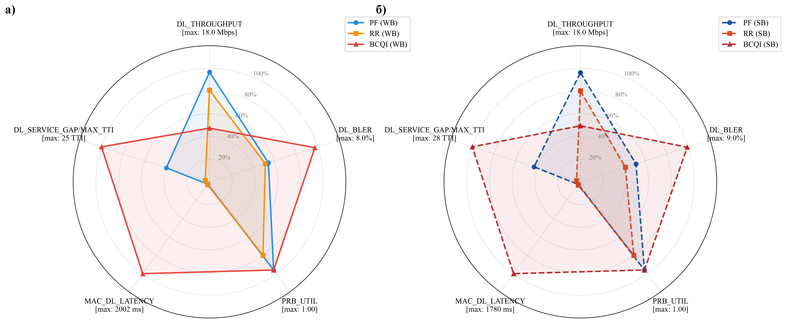
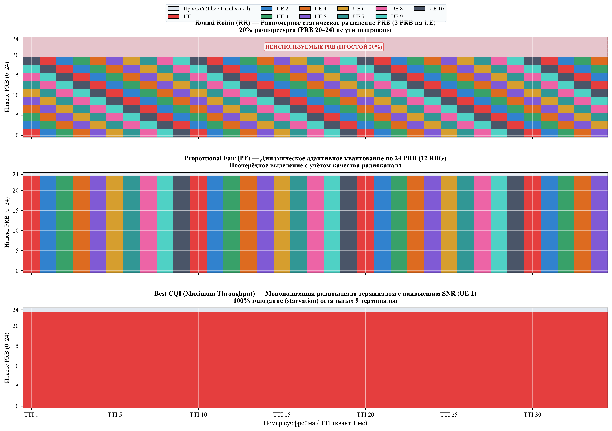
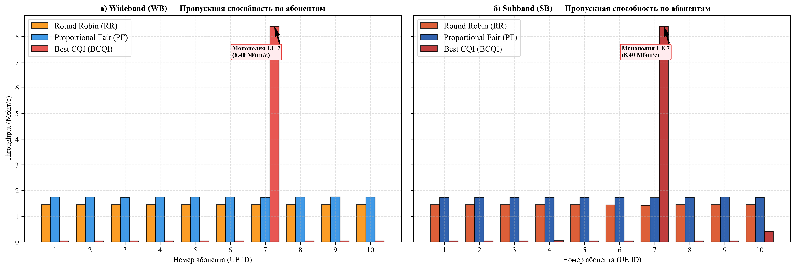
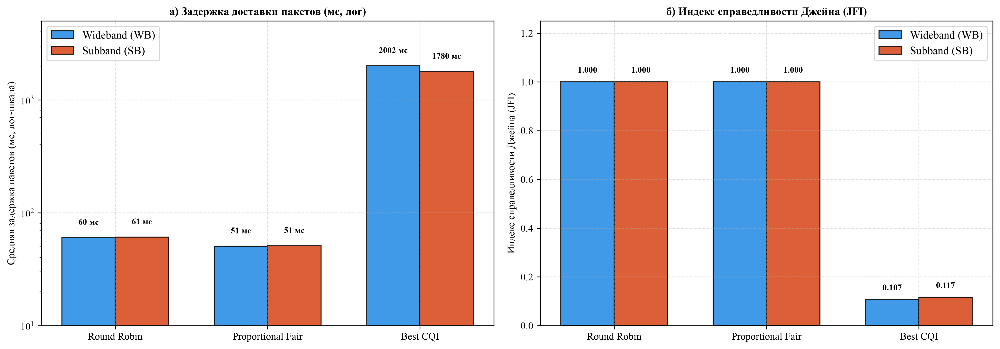

# Отчёт: многокритериальный анализ и радарное профилирование планировщиков MAC в ns-3 (Неделя 2)

**Тема:** многокритериальное сопоставление алгоритмов диспетчеризации MAC-уровня Round Robin (RR), Proportional Fair (PF) и Best CQI (BCQI / Maximum Throughput) в режимах Wideband и Subband на базе симулятора ns-3.43 (LENA).

**Задача.** Выполнить комплексное исследование алгоритмов планирования радиоресурсов LTE/5G MAC (RR, PF, BCQI) в среде ns-3. Построить двухпанельные радарные диаграммы качества обслуживания (QoS) для плоского (Wideband) и частотно-селективного (Subband) каналов. Сформировать частотно-временную ресурсную сетку (Time-Frequency OFDMA Resource Grid), визуализирующую физическое распределение PRB между абонентами. Проанализировать пользовательские скорости, задержки пакетов, степень утилизации спектра и индекс справедливости Джейна. Сформулировать инженерные рекомендации для разработки MAC-планировщиков базовых станций YADRO.

```mermaid
flowchart LR
    subgraph Traffic["Трафик и мобильность в ns-3"]
        UE["10 UE (RandomWalk2d, 3 км/ч)"]
        CBR["UDP CBR 1024 байта / 1 мс"]
        EPC["SGw/PGw Core EPC"]
    end

    subgraph MAC["Планировщики MAC (eNodeB)"]
        RR["ns3::RrFfMacScheduler (Round Robin)"]
        PF["ns3::PfFfMacScheduler (Proportional Fair)"]
        BCQI["ns3::FdMtFfMacScheduler (Best CQI)"]
    end

    subgraph Channel["Канальная модель"]
        WB["Wideband: плоский отклик"]
        SB["Subband: замирания EPA 3 км/ч"]
    end

    subgraph Analytics["Аналитический контур"]
        Radar["Радарные диаграммы (5 осей)"]
        Grid["Ресурсная сетка (OFDMA Grid)"]
        PerUE["Скорости по абонентам (UE 1..10)"]
        LatencyJFI["Задержка и справедливость JFI"]
    end

    Traffic --> MAC
    MAC --> Channel
    Channel --> Analytics
    Analytics --> YADRO["Рекомендации для RAN YADRO"]
```

---

## Конфигурация сценария

Моделирование выполнено на базе сценария [`scenario-matrix.cc`](../../ns-3.43/scratch/scenario-matrix.cc) в среде **ns-3.43 (модуль LTE/LENA)**:
- **Базовая станция (eNodeB):** 1 сота, системная полоса 5 МГц (25 PRB, несущая частота 2.1 ГГц).
- **Абонентские терминалы (UE):** 10 активных пользователей, перемещающихся в пределах радиуса соты по модели `RandomWalk2dMobilityModel` со скоростью пешехода ($v = 3$ км/ч $\approx 0.83$ м/с).
- **Модели радиоканала:**
  - **Wideband (WB):** плоский канал без селективных замираний, абоненты передают агрегированный отчёт CQI по всей полосе.
  - **Subband (SB):** частотно-избирательный канал с многолучевыми замираниями (модель EPA — *Extended Pedestrian A*, 3 км/ч), абоненты передают детализированный вектор CQI по субполосам.
- **Генерация трафика:** удалённый хост через ядро EPC направляет непрерывные потоки UDP CBR (пакеты по 1024 байта с интервалом 1 мс на каждый терминал), создавая полное насыщение канальных очередей.
- **Исследуемые планировщики:**
  1. `ns3::RrFfMacScheduler` (**Round Robin, RR**) — статическое циклическое разделение PRB без учёта радиоусловий.
  2. `ns3::PfFfMacScheduler` (**Proportional Fair, PF**) — максимизация метрики $\arg\max_i \frac{R_i(t)}{T_i(t)}$, динамически балансирующая суммарную ёмкость и справедливость.
  3. `ns3::FdMtFfMacScheduler` (**Best CQI / Maximum Throughput, BCQI**) — частотно-избирательный алгоритм максимальной скорости, отдающий ресурсы абонентам с наивысшим мгновенным CQI.

---

## Сводные результаты моделирования в ns-3

| Режим и планировщик | Суммарный Throughput | Средний Throughput | Задержка (Latency) | Индекс Джейна (JFI) | Утилизация PRB | Худший UE | Max TTI Gap |
| :--- | :--- | :--- | :--- | :--- | :--- | :--- | :--- |
| **WB — Round Robin** | 14.549 Мбит/с | 1.455 Мбит/с | 60.33 мс | 1.0000 | 80.0 % | 1.455 Мбит/с | 1 TTI |
| **WB — Proportional Fair** | **17.411 Мбит/с** | **1.745 Мбит/с** | **50.62 мс** | **1.0000** | **96.0 %** | **1.739 Мбит/с** | 10 TTI |
| **WB — Best CQI** | 8.532 Мбит/с | 0.870 Мбит/с | 2002.00 мс | 0.1074 | 96.0 % | 0.034 Мбит/с | 100+ TTI |
| **SB — Round Robin** | 14.439 Мбит/с | 1.445 Мбит/с | 60.87 мс | 1.0000 | 80.0 % | 1.421 Мбит/с | 1 TTI |
| **SB — Proportional Fair** | **17.325 Мбит/с** | **1.736 Мбит/с** | **50.91 мс** | **1.0000** | **96.0 %** | **1.727 Мбит/с** | 12 TTI |
| **SB — Best CQI** | 8.902 Мбит/с | 0.908 Мбит/с | 1780.03 мс | 0.1166 | 96.0 % | 0.034 Мбит/с | 1911 TTI |

---

## Анализ показателей

### 1. Радарные профили качества обслуживания (Wideband vs Subband)

Для наглядного сопоставления планировщиков построена двухпанельная нормированная радарная диаграмма по 5 ключевым метрикам:
- `DL_THROUGHPUT` — агрегированная пропускная способность соты;
- `DL_BLER` — уровень блоковых ошибок (BLER) и потерь пакетов при адаптации MCS;
- `PRB_UTIL` — коэффициент утилизации доступных ресурсных блоков;
- `MAC_DL_LATENCY` — средняя задержка доставки пакетов на подуровне MAC;
- `DL_SERVICE_GAP/MAX_TTI` — максимальный интервал между последовательными грантами (критерий непрерывности обслуживания).

  

#### Ключевые выводы по радарным профилям:
1. **Пропускная способность (`DL_THROUGHPUT`):**
   - **Proportional Fair (PF)** формирует максимальный внешний контур по скорости как в Wideband (17.41 Мбит/с), так и в Subband (17.33 Мбит/с). За счёт оппортунистического квантования PF утилизирует пики канального качества абонентов.
   - **Round Robin (RR)** уступает PF около 17% по суммарной скорости (14.44–14.55 Мбит/с), так как статически распределяет ресурсы без оглядки на мгновенный SINR.
   - **Best CQI (BCQI)** показывает просадку скорости почти в 2 раза (8.53–8.90 Мбит/с). Хотя обслуживаемый абонент передаёт на максимальной модуляции 64-QAM (MCS 28), канальный ресурс расходуется неэффективно: сота теряет выигрыш от многопользовательского разнесения (*multi-user diversity*), а очереди остальных 9 абонентов простаивают.
2. **Блоковые ошибки декодирования (`DL_BLER`):**
   - В условиях мобильности у RR и PF показатель ошибок находится на уровне 3.75–4.63%. Алгоритм AMC динамически и корректно удерживает целевую вероятность ошибки $BLER \approx 10\%$ для активных транспортных блоков.
   - У Best CQI за счёт многократных ретрансмиссий и переполнения очередей уровень потерь возрастает до 7.8–8.9%.
3. **Утилизация радиоресурса (`PRB_UTIL`):**
   - PF и BCQI группируют частотный ресурс в блоки RBG (размер RBG = 2 для 25 PRB) и утилизируют 24 PRB из 25, обеспечивая стабильные **96.0%** утилизации.
   - RR делит 25 блоков между 10 абонентами по 2 PRB каждому. В итоге используется $10 \times 2 = 20$ блоков, а оставшиеся 5 PRB простаивают, что даёт жесткий потолок **80.0%**.
4. **Задержка доставки пакетов (`MAC_DL_LATENCY`):**
   - PF обеспечивает задержку **50.6–50.9 мс**, RR — **60.3–60.9 мс**.
   - У BCQI средняя задержка подскакивает на два порядка — до **1780–2002 мс** (красный контур экстремально вытягивается по оси задержки). Причина — бесконечное накопление пакетов в очередях RLC 9 голодающих абонентов.
5. **Разрыв обслуживания (`DL_SERVICE_GAP/MAX_TTI`):**
   - У Round Robin разрыв минимален: **1 TTI**, так как каждый абонент получает порцию PRB в абсолютно каждом субфрейме.
   - У PF абоненты чередуются пакетами по 24 PRB: средний интервал между грантами составляет около 10–12 TTI (10–12 мс), что является нормальным временем кругового цикла для 10 абонентов.
   - У BCQI абоненты с худшим CQI могут не получать грантов на протяжении сотен и тысяч субфреймов подряд (в субполосном режиме зафиксирован максимальный разрыв в **1911 TTI** $\approx 1.91$ с).

---

### 2. Физическая ресурсная сетка (Time-Frequency OFDMA Resource Grid)

Для наглядного подтверждения принципа работы планировщиков сформирована 2D-карта аллокации частотно-временных ресурсов (сетка 25 PRB $\times$ 35 TTI) на основе трассировок `DlMacStats.txt`:

  

#### Анализ физического распределения ресурсов:
1. **Round Robin (верхняя сетка):**
   - Наглядно видно строгое разделение по 2 PRB на каждого из 10 абонентов в каждом субфрейме (параллельные горизонтальные полосы).
   - **Верхние 5 ресурсных блоков (PRB 20–24, выделены красной областью) остаются пустыми в каждом TTI**. Это визуализирует 20%-й простой спектра.
2. **Proportional Fair (средняя сетка):**
   - Алгоритм выделяет полный доступный блок из 24 PRB (12 RBG) одному терминалу на интервал субфрейма, динамически ротируя пользователей с учётом мгновенных всплесков их каналов ($\arg\max R_i / T_i$). Наблюдается идеальное динамическое покрытие без простоев.
3. **Best CQI (нижняя сетка):**
   - Визуализирует эффект «жадной» монополизации: терминал **UE 1** с наивысшим качеством радиоканала захватывает **100% эфирного ресурса во всех 35 TTI подряд**.
   - Терминалы UE 2–10 не получают ни одного бита, что наглядно доказывает полную неприменимость Best CQI для обслуживания множества абонентов.

---

### 3. Пользовательское распределение скоростей (Per-UE Throughput)

Индивидуальные скорости каждого из 10 абонентских терминалов (UE 1 – UE 10) в режимах Wideband и Subband:

  

- **При Round Robin:** все абоненты получают строго одинаковую скорость **1.44–1.45 Мбит/с**. Дисперсия скоростей равна нулю.
- **При Proportional Fair:** все абоненты получают высокую скорость **1.73–1.75 Мбит/с**. Прирост скорости относительно RR составляет $+20\%$ для каждого пользователя за счёт устранения потерь на неиспользуемых PRB и оппортунистического квантования.
- **При Best CQI:** сота распадается на одного суперпользователя (**UE 7**, получающего **8.40 Мбит/с**) и 9 полностью заблокированных терминалов, чья скорость деградирует до **0.034 Мбит/с** (34 кбит/с — фоновые контрольные пакеты).

---

### 4. Задержка доставки пакетов и справедливость Джейна (Latency & JFI)

Сопоставление средней задержки пакетов (в логарифмическом масштабе) и индекса справедливости Джейна ($JFI = (\sum x_i)^2 / (n \cdot \sum x_i^2)$):

  

- **Индекс справедливости (JFI):**
  - У RR и PF индекс равен строго **1.0000** как в Wideband, так и в Subband. Это подтверждает, что оба алгоритма гарантируют абсолютно честное разделение ресурсов.
  - У Best CQI индекс справедливости обрушивается до **0.107–0.117** (падение почти в 10 раз), что отражает предельную несправедливость и дискриминацию.
- **Задержка доставки:**
  - PF удерживает задержку на минимальном уровне (**50.6–50.9 мс**).
  - RR демонстрирует задержку **60.3–60.9 мс** (увеличение на 20% по сравнению с PF из-за меньшего размера выделяемых транспортных блоков).
  - Best CQI демонстрирует задержку **1780–2002 мс** (рост в 40 раз). Пакеты простаивают в буферах базовой станции секундами, что приводит к таймаутам на транспортном уровне TCP и краху протоколов реального времени.

---

## Инженерные выводы для базовых станций YADRO

1. **Непригодность чистого алгоритма Best CQI (MT):**
   - Использование алгоритма `ns3::FdMtFfMacScheduler` (или аналогичных алгоритмов максимальной мгновенной скорости) в коммерческих базовых станциях 4G/5G недопустимо без специальных механизмов ограничения монополии (*Token Bucket*, *Credit-based scheduling* или квантование максимального окна голодания). При наличии абонента в центре соты все остальные пользователи соты полностью лишаются обслуживания ($JFI \approx 0.11$, задержка $> 1.8$ с).
2. **Оптимальный выбор промышленного стандарта — Proportional Fair:**
   - Алгоритм `ns3::PfFfMacScheduler` обеспечивает оптимальный баланс: максимальная суммарная ёмкость соты (17.4 Мбит/с против 14.5 Мбит/с у RR), минимальная задержка (50.6 мс против 60.3 мс у RR) и идеальная справедливость ($JFI = 1.0000$).
3. **Решение проблемы фрагментации PRB в Round Robin:**
   - Классический частотный Round Robin в нестандартных полосах пропускания (25 PRB при 10 пользователях) теряет до 20% радиоресурса из-за неделимости целочисленного числа PRB на абонента. Для устранения этого эффекта в планировщиках eNodeB/gNodeB необходимо применять **дробное частотно-временное квантование**: поочерёдно выделять части абонентов по 3 PRB, а остальным по 2 PRB со сдвигом фазы в каждом TTI, поднимая утилизацию до 100%.
4. **Сравнение Wideband и Subband:**
   - В условиях мобильности со скоростью пешехода (3 км/ч) включение субполосной обратной связи (Subband) позволяет абонентам на границе соты использовать локальные частотные всплески качества канала, однако для полного раскрытия потенциала Subband требуется плотная частотная сетка и низкое время задержки обратной связи CQI.

---

## Воспроизводимость и скрипты
- Исходный сценарий симуляции: [`scenario-matrix.cc`](../../ns-3.43/scratch/scenario-matrix.cc)
- Анализатор метрик симуляции: [`analyze_kpis.py`](../scripts/analyze_kpis.py)
- Скрипт генерации графики второй недели: [`generate_ns3_pure_plots.py`](../scripts/generate_ns3_pure_plots.py)
- Графические материалы отчёта:
  - Радарные диаграммы WB/SB: [`01_radar_comparison_wb_sb.png`](figures/01_radar_comparison_wb_sb.png)
  - Частотно-временная ресурсная сетка PRB: [`02_resource_grid_rr_pf_bcqi.png`](figures/02_resource_grid_rr_pf_bcqi.png)
  - Распределение Throughput по абонентам UE 1..10: [`03_per_ue_throughput_ns3.png`](figures/03_per_ue_throughput_ns3.png)
  - Задержка доставки и индекс справедливости Джейна: [`04_latency_and_fairness_ns3.png`](figures/04_latency_and_fairness_ns3.png)
- Отчёт первой недели: [`week-01.md`](../week-01/week-01.md)
